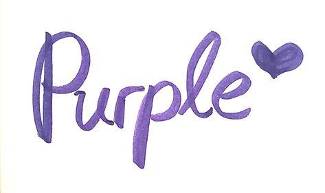

# Simple Background Remover
Simple script that removes paper background from text of other colors. 

Uses Image Formation Model function:  
Image = alpha(x).Color(x) + (1-alpha(x)).Background(x)

The goal is to recover alpha(x).Color(x)

1. Extract Background by using Morph close (that is Dillation followed by Erosion). 
2. Then, Extract alpha(x) by image/background and color(x) by median color value of original colored image (further can be implemented to pixel scale).
3. Create new image with rgb of median color value and clipped alpha value added.

